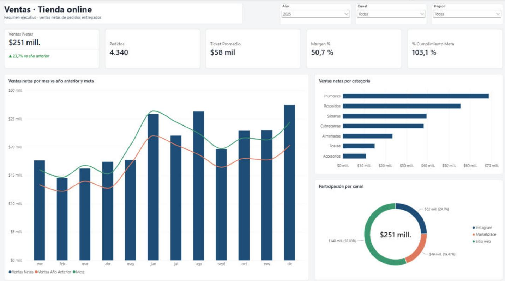
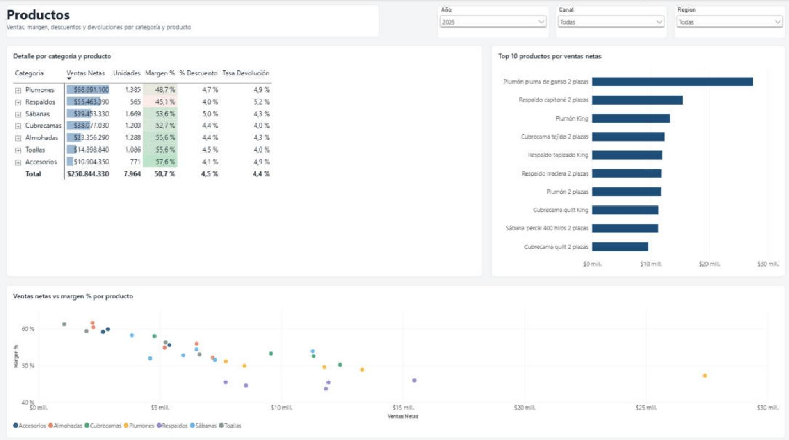
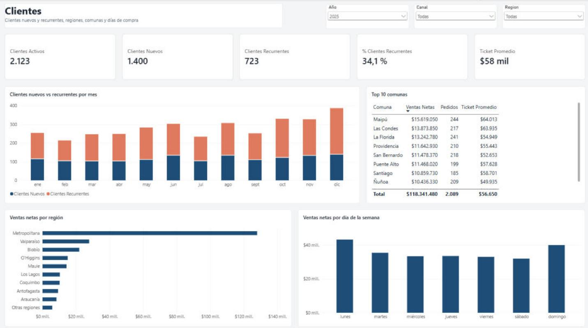

# 📊 Dashboard de ventas en Power BI · Tienda online

Dashboard interactivo en **Power BI** para una tienda online de ropa de cama, respaldos y accesorios. Muestra ventas, rentabilidad, cumplimiento de metas, productos y comportamiento de clientes, con datos de enero de 2024 a octubre de 2026.



| Productos | Clientes |
|---|---|
|  |  |

📄 [Ver el dashboard completo en PDF](docs/dashboard_ventas.pdf)

---

## Preguntas de negocio que responde

- ¿Cuánto vendemos y cómo vamos **contra el año anterior y contra la meta**?
- ¿Qué **categorías y productos** generan más ventas y más margen?
- ¿Qué **canal** (sitio web, Instagram, marketplace) aporta más?
- ¿Cuántos clientes son **nuevos** y cuántos **vuelven a comprar**?
- ¿En qué **meses, días y regiones** se concentran las ventas?

## Hallazgos principales (datos 2025)

| Indicador | Valor |
|---|---|
| Ventas netas | **$250,8 millones** (+23,7% vs 2024) |
| Cumplimiento de meta | **103,1%** |
| Margen bruto | **50,7%** |
| Ticket promedio | **$57.798** |
| Tasa de devolución | **4,4%** |

1. **Invierno y Navidad son las temporadas fuertes:** entre junio y agosto los **plumones** pasan de cerca del 18% a cerca del 50% de las ventas, y diciembre es el mes más alto del año.
2. **Los eventos de descuento mueven la aguja, con un costo:** en los meses con CyberDay, CyberMonday y Black Friday, el descuento sube al 8–10% de las ventas brutas, frente al 1–2% de un mes normal.
3. **El sitio web aporta el 56% de las ventas.** Instagram (25%) y marketplace (19%) complementan.
4. **Crecimiento acelerado en 2026:** entre enero y octubre, las ventas suben **31,1%** frente al mismo período de 2025.

## Contenido del dashboard

| Página | Contenido |
|---|---|
| **Resumen** | Indicadores clave, variación contra el año anterior, cumplimiento de meta, tendencia mensual, categorías y canales. |
| **Productos** | Matriz por categoría y producto con formato condicional, top 10 de productos y relación ventas/margen. |
| **Clientes** | Clientes nuevos vs recurrentes, ventas por región, comuna y día de la semana. |

## Modelo de datos

Modelo en estrella, con una tabla de hechos y dimensiones:

```
              Productos
                  │
Clientes ──── Ventas (hechos) ──── Calendario ──── Metas
```

- **Ventas:** 19.890 líneas y 13.275 pedidos. Incluye cantidad, precio, descuento, canal, medio de pago y estado.
- **Productos:** 32 productos en 7 categorías, con precio y costo.
- **Clientes:** 4.200 clientes con región, comuna y canal de adquisición.
- **Metas:** meta mensual de ventas.
- **Calendario:** tabla de fechas creada con DAX, que permite usar inteligencia de tiempo.

## Medidas DAX destacadas

Hay 25 medidas en [`powerbi/medidas.dax`](powerbi/medidas.dax). Algunas:

- `Ventas Año Anterior` con `SAMEPERIODLASTYEAR`, y `Var % Año Anterior`.
- `% Cumplimiento Meta` y `Ventas Acumuladas Año` con `TOTALYTD`.
- `Margen %` usando el costo desde la dimensión de productos con `RELATED`.
- `Clientes Nuevos`, que detecta la primera compra de cada cliente con `CALCULATE` + `ALL`.
- Textos y colores dinámicos para mostrar la variación con ▲/▼.

## Estructura

```
├── datos/ventas_tienda.xlsx      # datos de origen (ficticios)
├── dashboard_ventas.pbip         # proyecto de Power BI (formato de texto, ideal para Git)
├── dashboard_ventas.Report/      #   definición del informe (páginas y visuales en JSON)
├── dashboard_ventas.SemanticModel/ # modelo de datos y medidas DAX (TMDL)
├── powerbi/
│   ├── dashboard_ventas.pbix     # el mismo dashboard en un solo archivo
│   ├── medidas.dax               # todas las medidas DAX
│   └── tema_tienda.json          # tema de colores
├── docs/                         # capturas, PDF e imagen de referencia del diseño
├── scripts/
│   ├── generar_datos.py          # genera el dataset
│   ├── valores_control.py        # recalcula los indicadores en Python para validar el dashboard
│   └── referencia_visual.py      # imagen de referencia del diseño
└── GUIA.md                       # construcción paso a paso
```

## Tecnologías

Power BI Desktop · DAX · Power Query · modelado dimensional · Power BI Project (PBIP/TMDL) · Python (pandas) para la generación y validación de datos

---

> Todos los datos son **ficticios**, generados con `scripts/generar_datos.py`.

**¿Necesitas un dashboard para tu negocio?** Contáctame: clayer2001@gmail.com
